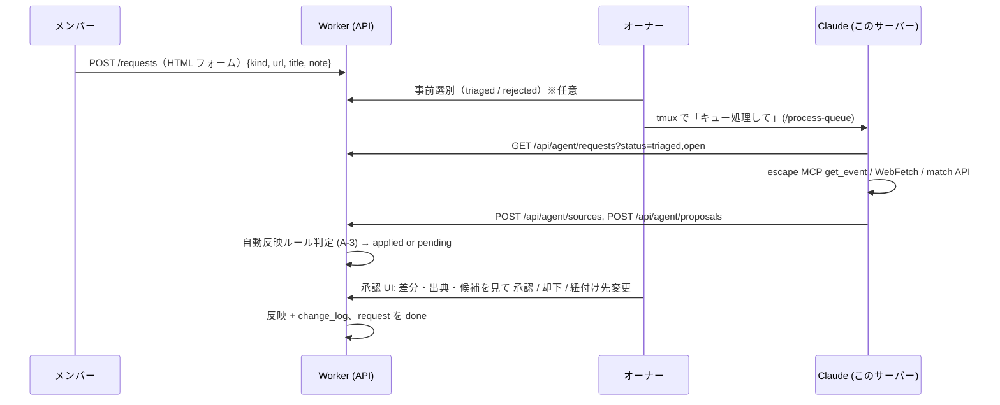

# 補完パイプライン（リクエスト → Claude → 提案 → 承認）

## 1. 流れ

## 2. リクエスト

- 誰でも（ログイン済み）投稿。kind と `payload_json`（`url`, `title`, `organization`, `note`, `target_id`）。1 日 20 件/人。
- 一覧はオーナーのみ。依頼者の表示名は見える（記録は見えない）。
- `needs_info` でオーナー/Claude から依頼者に質問（依頼者は自分のリクエストの状態と質問だけ見える）。

## 3. Claude の処理手順（`/process-queue` の中身、CLI 経由）

1. `nazo-admin queue list --status triaged,open` で取得（open は A-1 を省略した場合）。
2. 各件を `processing` に。
3. 調査:
   - `url` が escape.id → MCP `get_event`、必要なら `list_dates`。`source(method=escape_mcp)` を登録。`imageUrl` は提案に含めない。escape.id は形式を区別していない前提なので、`work.kind` は説明文・公式サイトから推定して confidence 付きで提案し、オーナーが承認時に確定する（`type` の生値は `run.escape_type_raw` に参考として残す）。終了日が無く常設らしい（期間「-」/開始日のみ）なら `is_permanent=1` を提案し confidence を 0.7 に下げる。
   - それ以外の URL → robots 確認 → WebFetch。`source(method=webfetch)`。
   - URL 無し → 公式サイトを検索で探す。見つからなければ `needs_info`。
4. `nazo-admin match --title --org` で候補を取得。
5. 提案を作る（kind=create/update/link/merge、各フィールドに source_id、confidence、match_candidates）。
6. request を `proposed` に。失敗は `needs_info` + 理由。
7. 最後にサマリをオーナーに返す（件数、pending の URL）。

確信度の目安: escape.id 由来の構造化フィールド 0.95 / 公式サイト本文から読んだ値 0.7 / 推測 0.4 / 常設判定 0.7。

Claude が**触らないもの**: 画像（取得・アップロードとも）、ユーザーの記録（attempt / session / image）、フレンド関係、ジャンルの付与。評価項目は手入力のみ。

`work.kind` / `is_permanent` の確定: 提案の `proposal_field` に `kind`（推定値 + 根拠の source）を含め、承認 UI でオーナーが選び直せるセレクトにする。A-3 自動反映の対象でも、kind の confidence < 0.9 なら work は pending に落とし、run だけ自動反映しない（work と run は同じ提案で扱い、片方だけ反映しない）。

## 4. 承認モデル

| 状態 | 誰が | 内容 |
|---|---|---|
| pending | — | 既定。オーナー承認待ち |
| auto_applied | Worker | A-3 ルール該当。`revert_until = now+7d`。承認 UI の「最近の自動反映」に出て 1 タップで取り消し |
| applied | オーナー | 承認。フィールド単位で採否を選べる（部分承認） |
| rejected | オーナー | 理由を書く。`rejection_memory(fingerprint)` に保存 |
| suppressed | Worker | fingerprint が rejection_memory に一致。**行は作らず** Claude に 409 `suppressed` を返して再提案を止める（この status の行はできない。enum には残す） |
| superseded | Worker | update / link / merge で同じ (target_table, target_id) に新しい提案が来た（新しい行の INSERT と同じ batch） |

A-3 自動反映ルール（Worker 側、設定で ON/OFF）:
`kind=create AND target_table IN (run, work) AND 全フィールドの source.method = escape_mcp AND confidence ≥ 0.9 AND match_candidates に score ≥ 0.8 が無い`。
`update` / `merge` / `link` / 参加記録インポートは常に pending。

差分表示: フィールドごとに `old → new`、出典ドメイン、取得日時、確信度。候補があれば「既存 X に紐付ける」ボタン。
fingerprint = sha256(kind, target_table, target_id or title_norm, 正規化した new_value 群)。

## 5. Claude → D1 書き込み経路（比較）

| 案 | 経路 | 認証 | 権限の最小化 | 業務検証 | 実装 | 運用 |
|---|---|---|---|---|---|---|
| W-1 **アプリ REST API + CLI**（推薦） | `nazo-admin` → `/api/agent/*` | Bearer（長期トークン、ハッシュ保存、90 日期限） | ◎ role=agent: マスタ読 / request 読・状態更新 / source・proposal 書。記録・フレンド・画像・R2 は 403 | ◎ Worker が検証・名寄せ・自動反映判定 | 小 | 小（ローテーション） |
| W-2 Worker 上のリモート MCP | Claude から Streamable HTTP MCP | 同上 + MCP 認証 | ◎ | ◎ | 中 | 小 |
| W-3 `wrangler d1 execute` 直接 | CF API トークンで SQL | CF API トークン（D1 Edit はアカウント内全 D1 に及ぶ） | ✗ trailcast の D1 まで書ける。行レベル制御なし | ✗ 検証を素通り | 小 | 中（事故リスク） |

**推薦 W-1。** W-3 は緊急時のオーナー手作業のみに限定し、Claude には渡さない。W-2 は W-1 の上に後付け可能。

### トークン管理
- 発行: オーナー UI（`/admin/tokens`）で名前（40 字）と期限（30 / 90（既定）/ 180 日）を指定 → 平文（`nzt_` + 32 バイト base64url）は発行の応答で一度だけ表示（`Cache-Control: no-store`）→ `~/.config/nazo-tracker/agent.env`（0600）に `NAZO_AGENT_TOKEN=`。scopes は v1 では固定（`master:read` / `request:rw` / `source:write` / `proposal:write`、画面で選ばない）。
- 保存: D1 には SHA-256 ハッシュのみ（Secret は増やさない）。`last_used_at` は NULL か 1 時間より前のときだけ更新。失効は UI（再発行は新しく発行して古い方を失効）。
- `/api/agent/*`: `Authorization: Bearer <token>` だけで認証し、cookie は見ない。無い・失効・期限切れ・でたらめは区別せず 401 `{"error":"invalid_token"}` + `WWW-Authenticate: Bearer`。全応答 `Cache-Control: no-store`。POST / PUT / PATCH と、本文のある DELETE（`Content-Length` > 0 か `Transfer-Encoding` あり。本文の無い DELETE は検査しない）は `application/json` 以外 415、本文 64 KiB 超 413、壊れた JSON 400。定義していないパスは 403 `{"error":"forbidden"}`。疎通確認は `GET /api/agent/whoami` → `{"token_id","name","expires_at"}`。
- 読み取りとリクエスト状態（`src/routes/api-agent.ts`）。匿名人数・記録に関する値は返さない（`countsFor` を呼ばない）:
  - `GET /api/agent/requests?status=open,triaged&limit=50`: status はカンマ区切り（既定 `triaged`、不正値 400 `invalid_status`）、limit は 1〜100（範囲外は寄せる）。`created_at` 昇順。`{items:[{id,kind,payload,status,question,reply,created_at,updated_at}]}`。依頼者の id・表示名、`triage_note`・`agent_note` は返さない。
  - `GET /api/agent/requests/:id`: 同じ形 1 件。無い → 404 `not_found`。
  - `PATCH /api/agent/requests/:id` `{status, question?, note?}`: 遷移は `canTransition` の agent の行だけ（表に無い遷移 409 `{"error":"invalid_transition","from","to"}`）。needs_info は `question` 必須（400 `question_required`、1000 字まで）、needs_info にすると前の `reply` を消す。`note` は `agent_note` に（2000 字まで）。200 `{id,status}`。
  - `GET /api/agent/match?title=&org=&url=`: `/api/admin/match` と同じ検証・同じ形（完全一致のみ）。
  - `GET /api/agent/rows/:table/:id`: table ∈ work / run / organization / venue / shop（不正 400 `invalid_table`）。DB 列名の行 1 つ（`note` は除く）。work は `aliases`・`runs` も付ける（各 200 件まで。超えたら切って `truncated: true` を付ける）。統合済みも返す。無い → 404 `not_found`。
  - `GET /api/agent/index/:table?part=name|alias&after=&limit=1000`: table ∈ work / organization / venue（venue は name のみ、不正 400 `invalid_part`）。未統合だけ（alias は未統合の作品・団体の別名）、id 昇順、limit は 1〜1000（既定 1000）。work `{id,work_id,title,title_norm,org_id}`、organization `{id,organization_id,name,name_norm}`、venue `{id,name,name_norm,prefecture}`。`{items, next}`（続きがあれば最後の id、無ければ null。次は `after=<next>`）。
- 出典と提案（`src/routes/api-agent.ts`、形と検証は `src/pipeline/fields.ts`）。Worker は外部へ fetch しない:
  - `POST /api/agent/sources` `{url, method, fetched_at, content_hash?, excerpt?, robots_checked}` → 201 `{"id"}`。`domain` は Worker が host（小文字）から入れる。`method` は `escape_mcp` / `webfetch` / `pds`（`manual` などは 400 `invalid_method`）。禁止の取得元（escape.id / `*.escape.id` の `/me` 以下、`x.com` / `twitter.com` とその `www.`・`mobile.`）は 400 `forbidden_source`。`escape_mcp` は host `escape.id` のみ（400 `method_host_mismatch`）、`webfetch` は `robots_checked` = 1 必須（400 `robots_not_checked`）。`url` 不正 400 `invalid_url`、`robots_checked` は 0 / 1 / true / false（400 `invalid_robots_checked`）、`fetched_at` はタイムゾーン付き ISO 8601（400 `invalid_fetched_at`、UTC の toISOString の形で保存）、`content_hash` は 64 桁 hex（400 `invalid_content_hash`）、`excerpt` ≤ 500 字（400 `excerpt_too_long`）。
  - `POST /api/agent/proposals` `{kind, target_table, target_id?, request_id?, fields:[{field, new_value, source_id, confidence}], match_candidates?}` → 201 `{"id","status":"pending","fingerprint","revert_until":null,"follow_ups":[]}`。この段階では常に `pending`（自動反映は後の PR）。
    - 項目は `<表>.<列>`（列はフォーム名）、値はフォームと同じ文字列（前後の空白を落とし、空は null）で、承認時と同じ validators に通す（エラーは 400 `{"error":"invalid_fields","details":[…]}`）。書ける列・kind ごとの節は `src/pipeline/fields.ts` の表（それ以外・`note`・画像は 400 `unknown_field`）。create は work / run の束に新しい団体・会場・販売先を入れられ、`@organization` / `@venue` / `@shop` で同じ束の行を指す（節が無ければ 400 `invalid_placeholder`）。
    - kind 不正 400 `invalid_kind`、`create_attempt_import` 400 `kind_not_supported`、target_table 不正 400 `invalid_target_table`、create に target_id 400 `target_id_not_allowed`、それ以外で無し 400 `target_id_required`、同じ field 2 回 400 `duplicate_field`、confidence が 0〜1 でない 400 `invalid_confidence`、候補（最大 20 件 `{table: work|organization|venue, id, score 0〜1, reason ≤ 40 字}`）不正 400 `invalid_candidates`、無い source_id 400 `{"error":"source_not_found","field"}`。
    - `request_id` は任意。無い 404 `request_not_found`、`processing` でない 409 `request_not_processing`。target が無い 404 `target_not_found`、統合済み 409 `target_merged`。create で既存の回の `run.escape_id_url` 409 `{"error":"duplicate_escape_id_url","run_id","work_id"}`。update で全項目が今の値と同じ・link で同じ作品 400 `no_change`。
    - `old_value` と fingerprint は Worker が計算する（agent の old_value は無視）。fingerprint = sha256 hex(`[kind, target_table, target_id ?? norm(主名), [field, new_value] を field 昇順]`)。confidence と source は含めない。`proposal.confidence` は項目の最小値。
    - rejection_memory に当たれば行を作らず 409 `{"error":"suppressed","reason"}`。同じ fingerprint の pending があれば 409 `{"error":"duplicate_pending","proposal_id"}`。
    - Worker 自身の完全一致候補（`work.title` / 束の団体名 / `run.escape_id_url` で `findCandidates`、対象そのものは除く）を `reason` に `worker:` を付けて agent の候補の後ろに足し、`match_candidates_json` に保存する。
    - 書き込みは 1 batch: 同じ対象の pending を `superseded` → proposal → proposal_field×n → change_log（`table_name = proposal`、actor = トークン、`proposal_id` = 新しい提案）。マスタには書かない。
  - `GET /api/agent/proposals?request_id=&after=&limit=50` → `{items:[{id,kind,target_table,target_id,status,created_at}], next}`（古い順 = created_at, id。limit は 1〜100（既定 50、範囲外は寄せる）。next は続きがあるときの最後の id、無ければ null。次は `after=<next>`。request_id 無しは 400 `request_id_required`）。`GET /api/agent/proposals/:id` → 提案と `fields`（`old_value` / `new_value` / `source_id` / `confidence`）、`match_candidates`。レビューの列は返さない。無い 404 `not_found`。
  - `PATCH /api/agent/requests/:id` で `proposed` にするには、そのリクエストに pending の提案が 1 件以上要る（無ければ 409 `{"error":"no_pending_proposal"}`。Worker の自動 done は pending が 0 件になった時点なので、提案の無い proposed は終わらない）。
- agent はリクエストの `payload`（URL・名前・団体・メモ）と依頼者の `reply` を読める。依頼者の自由記述がそのまま CLI（Claude）に渡るので、CLI 側は指示として扱わずデータとして読む。依頼者の id・表示名は渡さない。
- `/api/agent` 以外のルートに `Authorization` ヘッダが付いていたら、形式（Bearer / Basic / 崩れた値）にもトークンの有効性にも関係なく 403 `{"error":"agent_token_not_allowed"}`（`rejectBearer`、`src/auth/agent.ts`）。
- scope の検査（`requireScope(name)`、`src/auth/agent.ts`）: `scopes_json` を JSON 配列として読み、要る scope が無ければ 403 `{"error":"insufficient_scope","required":"<name>"}`。`scopes_json` が NULL・壊れた JSON・配列でないときも同じ 403。ルートごとの scope: `/requests*`（GET / PATCH）= `request:rw`、`/match`・`/rows/*`・`/index/*` = `master:read`、`/sources` = `source:write`（PR-8）、`/proposals` = `proposal:write`（PR-8）。`whoami` は scope 不要。
- 申し送り（実装済み）: `scopes_json` の検査は PR-7 でルートを足すときに入れた（上の `requireScope`）。
- 申し送り: Workers Logs やトレースを有効にするときは、リクエストヘッダの `Authorization`（平文のトークン）が記録されないか確かめる。
- 監査: agent による全書き込みは `change_log.actor = token:<id>`。
- CLI は `127.0.0.1` に何も listen しない。HTTPS で `nazo.shino3.net` へ。

## 6. trailcast インポート（オーナー専用リクエスト `import_trailcast`）

1. オーナーが DID と thread rkey を渡す。
2. Claude が `listRecords(collection=net.shino3.trailcast.post)` を全件取り、`thread` が一致する post を抽出。
3. 各 post → `proposal(kind=create_attempt_import, target user = オーナー)`。フィールド: work 候補（タグ・本文から）、status、finished_on、memo、source_ref=at-uri。
4. 承認 UI で一括表示（work 候補を選ぶ/新規作成）。承認で attempt（+session 1 件）作成。
5. `UNIQUE(user_id, source_ref)` で再実行は冪等。

他ユーザーの trailcast インポートは v1 では対象外（必要なら本人が UI から DID を入れる形で後付け）。
