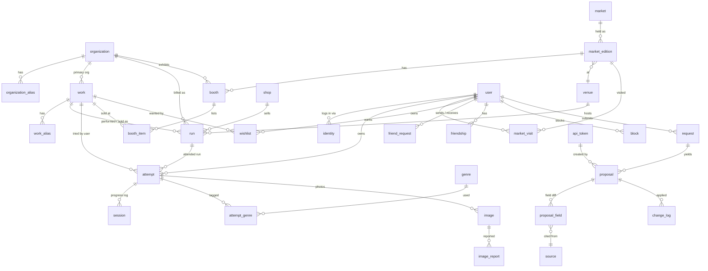

# データモデル

主文書: [design.md](./design.md)。D1 (SQLite)。ID は ULID（TEXT 26 桁）。日時は ISO 8601 TEXT（UTC）、日付は `YYYY-MM-DD` TEXT。真偽は INTEGER 0/1。

## 1. ER 図



## 2. マスタ（全ユーザー共有、読み取りは誰でも）

### organization（団体）
| 列 | 型 | 備考 |
|---|---|---|
| id | TEXT PK | |
| name | TEXT NOT NULL | 現在の正式名 |
| name_norm | TEXT NOT NULL | 正規化名（§5）。INDEX |
| slug | TEXT UNIQUE NULL | escape.id の `<slug>-org` |
| site_url | TEXT NULL | |
| escape_id_url | TEXT UNIQUE NULL | `https://escape.id/<slug>-org/` |
| note | TEXT | |
| merged_into_id | TEXT NULL FK | マージ先 |
| created_at / updated_at | TEXT | |

### organization_alias
| 列 | 備考 |
|---|---|
| id, organization_id FK | |
| name, name_norm | INDEX(name_norm) |
| kind | `former_name` / `alt_spelling` / `label`（レーベル・ブランド名） |
| since / until | 日付 NULL 可 |

### work（作品）
| 列 | 備考 |
|---|---|
| id | |
| title, title_norm | INDEX(title_norm) |
| kind | `hall` / `room` / `stroll`(周遊) / `line` / `web` / `takeaway`(持ち帰り) / `other` |
| primary_organization_id FK NULL | |
| official_url UNIQUE NULL | 正規化後 |
| description | **画像は持たない**（escape.id `imageUrl` は保存しない） |
| player_min / player_max / estimated_minutes / time_limit_minutes | escape.id から |
| first_released_on | 初演・発売日（分かれば） |
| merged_into_id FK NULL | |
| created_at / updated_at | |

### work_alias
`id, work_id, title, title_norm, kind(former_title / alt_spelling / subtitle)`

### venue（会場）
`id, name, name_norm, prefecture, address, organization_id NULL(常設店舗の運営団体), merged_into_id`

### shop（販売先）
`id, name, kind(booth / official_store / physical_store / other), url UNIQUE NULL, organization_id NULL`

### run（回: 公演・配信・販売）
| 列 | 備考 |
|---|---|
| id, work_id FK NOT NULL | |
| channel | `performance`（会場公演）/ `online`（LINE・Web 配信）/ `sale`（持ち帰り販売） |
| organization_id FK NULL | 当時の主催（名義団体） |
| billed_as | TEXT 当時の表記スナップショット |
| venue_id FK NULL | performance |
| shop_id FK NULL | sale |
| start_on / end_on | NULL 可（周遊・常設は end 無し） |
| is_permanent | INTEGER 0/1。常設ルーム・カフェ型など。`end_on` を入れたら終了扱い |
| escape_id_url UNIQUE NULL | `https://escape.id/<org>-org/e-<slug>/` 正規化 |
| ticket_url, price_yen | |
| escape_type_raw | escape.id `type` の生値（参考のみ。kind 判定には使わない） |
| note | |
| created_at / updated_at | |

**持ち帰り謎の販路**: 1 作品に販売サイト・イベントが複数ある前提。販売サイトごとに `run(channel='sale', shop_id)` を 1 行、マーケット出店は `booth_item(work_id)` で紐付ける。作品ページでは `v_work_channels`（work ⋈ run(sale) ⋈ shop ∪ work ⋈ booth_item ⋈ booth ⋈ market_edition）で「どこで売っている/売っていたか」を時系列に一覧する。これはマスタ側の情報で、個人の購入記録とは結び付けない。

CHECK: `channel='sale' → shop_id NOT NULL`、`channel = 'performance' OR venue_id IS NULL`、`channel = 'sale' OR shop_id IS NULL`（venue_id は performance のみ、shop_id は sale のみ）。

**ルーム型・常設**: `work.kind='room'` + `run(channel='performance', venue_id=店舗, start_on NULL 可, end_on NULL, is_permanent=1)`。一覧ビュー `v_room_by_venue`: venue(prefecture, name) ⋈ run(is_permanent=1 AND (end_on IS NULL OR end_on >= date('now'))) ⋈ work(kind='room')。都道府県 → 店舗 → 作品で並べる。

### work.kind の決め方
escape.id は謎解きの「枠（チケット）」を売る場で、作品の形式（ルーム型か等）を信頼できる形では区別していない前提とする。`work.kind` は提案時に Claude が説明文・公式サイトから**推定して confidence 付きで提示**し、オーナーが承認時に確定する。escape.id の `type`・表示ラベルは `run.escape_type_raw` に生値で残すだけで、自動変換表は持たない。

### market / market_edition / booth / booth_item（出店）
- `market(id, name, name_norm, site_url)` — 例: ゲームマーケット、ナゾトキマーケット
- `market_edition(id, market_id, label, start_on, end_on, venue_id NULL, escape_id_url NULL, source_url, external_key)` — `external_key` = gamemarket.jp の `target_gm=2026a`
- `booth(id, market_edition_id, organization_id NULL, name_as_listed, booth_no, detail_url, days)` — UNIQUE(market_edition_id, detail_url)
- `booth_item(id, booth_id, work_id NULL, title_as_listed, price_yen)`

## 3. ユーザー領域（本人。フレンドには status 射影のみ）

### user / identity / session_token / recovery_code → [auth.md](./auth.md)

### attempt（挑戦 = 記録の単位）
| 列 | 備考 |
|---|---|
| id, user_id FK NOT NULL | **全クエリで user_id を絞る** |
| work_id FK NOT NULL | |
| run_id FK NULL | 公演回が分かるとき |
| status | `purchased`(買った) / `in_progress` / `cleared` / `failed` / `dropped` |
| purchased_on | 買った日 NULL 可。status=purchased で作り、遊び始めても値は残す |
| attempt_no | 同一 work の何回目か（再挑戦） |
| started_on / finished_on | NULL 可。session があれば派生（min/max）で埋める |
| duration_sec | 公演なら所要、周遊なら合計（session の合計で上書き可） |
| party_size | |
| companions | TEXT 自由記述（決定） |
| rating | 1-5 NULL 総合評価 |
| difficulty | 1-5 NULL 自分にとっての難易度 |
| volume | 1-5 NULL 謎の物量 |
| memo | 通常メモ。share level `memo` でフレンドに見える |
| spoiler_memo | ネタバレメモ。**本人のみ。認可層で常に除外、設定項目なし（決定）** |
| share_override | NULL（ユーザー既定に従う）/ `hidden` / `status` / `rating` / `memo`。**v1 では常に NULL（UI 無し）**、P11 で使う |
| source_ref | trailcast at-uri 等。UNIQUE(user_id, source_ref) |
| created_at / updated_at | |

INDEX(user_id, status), INDEX(user_id, finished_on), INDEX(user_id, work_id), **INDEX(work_id, status, user_id)**（匿名人数用）.

**軽い記録** = `work_id + status` のみ（日付・同行者 NULL）。**詳しい記録** = 上記 + session + 評価項目 + 画像。

### genre / attempt_genre（ジャンル、固定リスト・複数選択）
- `genre(id, label, sort_order, archived INT)` — 初期値: ひらめき / 論理 / 物量 / ストーリー / 探索 / 大謎一発 / 協力 / 体験・演出（決定）。オーナーが追加・archived。自由タグは v1 では持たない
- `attempt_genre(attempt_id, genre_id, user_id)` PK(attempt_id, genre_id)。user_id 冗長（絞り込み用）

### image（写真。全てユーザー撮影、記録に属する）
| 列 | 備考 |
|---|---|
| id, user_id FK, attempt_id FK | |
| kind | `key_visual`（会場のキービジュアルパネル）/ `clear_panel` / `other` |
| spoiler | INT。本人は既定で畳む。**spoiler=1 は常に本人のみ（認可で固定）** |
| r2_key, thumb_r2_key | `u/<user_id>/<image_id>.webp` 等。バケットは非公開 |
| width, height, bytes, content_type | |
| removed_at, removed_reason | オーナーの非表示。7 日後に R2 から削除 |
| created_at | |

制約: 1 attempt 4 枚、1 枚 2MB、ユーザー合計 300MB（`SUM(bytes)` を INSERT 前に確認）。
`image_report(id, image_id, reporter_user_id, reason, created_at)` UNIQUE(image_id, reporter_user_id)。

### friend_request / friendship / block
- `friend_request(id, from_user_id, to_user_id, status(pending / accepted / declined / canceled), created_at, responded_at)` UNIQUE(from,to) WHERE pending、CHECK(from_user_id <> to_user_id)
- `friendship(user_lo, user_hi, created_at)` PK(user_lo, user_hi)、`user_lo < user_hi` で 1 行。INDEX(user_hi)。解除で削除
- `block(user_id, blocked_user_id, created_at)` PK(user_id, blocked_user_id)、CHECK(user_id <> blocked_user_id) — ブロック中は friendship を削除し、申請不可、相手からは「存在しない」と同じ応答
- `user.friend_code`（短いランダム、再発行可、NULL で招待停止）、`user.default_share_level`（既定 `status`、v1 は固定で UI 無し）、`user.exclude_from_counts`（匿名人数から外す、既定 0）→ auth.md

### session（進行ログ）
| 列 | 備考 |
|---|---|
| id, attempt_id FK, user_id FK | user_id を冗長に持ち、絞り込みを単純化 |
| played_on NOT NULL, started_at / ended_at NULL | |
| duration_sec | |
| progress_note | 「第 3 章まで」等 |
| companions, memo, venue_id NULL, location_text | |
| created_at | |

公演型は session 0〜1 件。周遊・持ち帰り・Web 謎は複数。attempt.status の更新は手動（セッション追加時に「進行中のまま / クリア / 断念」を選ぶ）。session の公開範囲は親 attempt に従う（`memo` level で日付・メモ、`status` level では日付のみ）。

### 購入の扱い
購入専用テーブルは持たない。「買った」は attempt の `status = purchased` で表す（買った場所・価格は持たない）。遊び始めたら同じ行を `in_progress` 以降に進める。

### wishlist（マイリスト: これから遊びたい）
| 列 | 備考 |
|---|---|
| user_id FK, work_id FK | PK(user_id, work_id) |
| memo | 「友達と行く」「冬まで」等 |
| created_at | |

- **外すのは手動のみ（決定）。** attempt の状態で自動削除・自動アーカイブはしない。一覧は本人の attempt を LEFT JOIN して status の印（買った / 進行中 / クリア済み / 失敗 / 断念）を付け、「未プレイのみ」フィルタを持つ。
- 中身は**本人のみ**（v1 はフレンドにも出さない）。
- **escape MCP の watchlist とは別物**（あちらは MCP サーバーの DB。同期しない）。
- INDEX(work_id) — 匿名人数用。

### market_visit（マーケット来場）
`id, user_id, market_edition_id, visited_on, memo`

## 4. 補完パイプライン（→ [agent-pipeline.md](./agent-pipeline.md)）

- `request(id, requester_user_id NULL, kind, payload_json, status, triage_note, created_at, updated_at)`
  - kind: `new_work` / `fix_work` / `new_organization` / `new_shop` / `new_booth` / `new_room_venue`（常設店舗の公式 URL を渡す）/ `new_genre` / `import_trailcast` / `other`
  - status: `open` → `triaged` | `rejected` → `processing` → `proposed` → `done` | `needs_info`
  - INDEX(status)
- `source(id, url, domain, method(escape_mcp / webfetch / manual / pds), fetched_at, content_hash, excerpt, robots_checked)`
- `proposal(id, request_id NULL, kind, target_table, target_id NULL, confidence REAL, status(pending / applied / auto_applied / rejected / superseded / suppressed), fingerprint（部分 UNIQUE: `WHERE status = 'pending'`）, created_by_token_id, created_at, reviewed_at, reviewer_user_id, review_note, revert_until)`
  - kind: `create` / `update` / `link`（run→work）/ `merge` / `create_attempt_import`
  - `match_candidates_json`: 名寄せ候補 `[{table,id,score,reason}]`
  - INDEX(status), INDEX(target_table, target_id)
- `proposal_field(id, proposal_id, field, old_value, new_value, source_id NULL)` — フィールド単位の差分と出典
- `rejection_memory(fingerprint PK, reason, created_at)` — 同じ提案の再発を `suppressed` にする
- `change_log(id, table_name, row_id, action, before_json, after_json, actor_user_id NULL FK user, actor_token_id NULL FK api_token, proposal_id NULL, created_at)` — CHECK: actor_user_id と actor_token_id のちょうど片方が NOT NULL。INDEX(table_name, row_id)
- `api_token(id, name, token_hash, role(agent), scopes_json, expires_at, last_used_at, revoked_at, created_at)`

## 5. 名寄せ

正規化 `norm()`（`src/lib/norm.ts`）:

```
norm(s):
  t = s.normalize('NFKC').toLowerCase()
  u = t.replace(/【[^】]*】/gu, '')                // 【…】は中身ごと除去（【追加公演】など）
        .replace(/[\s\p{P}\p{S}]/gu, '')       // 空白・句読点・記号。「」『』・〜 は \p{P} に入る（括弧文字だけ消える）
  if (u === '') u = t.replace(/\s/gu, '')          // 記号だけの名前は記号を残す
  v = u.replace(/(再演|再々演|20\d\d|第\d+弾)+$/u, '')
  return v === '' ? u : v                          // 「2026」だけの題名を空にしない
```

- `name_norm` / `title_norm` は INSERT / UPDATE 時にサーバーが必ず計算する（フォームに項目を出さない）。
- 検索では `norm()` の結果を `LIKE ? ESCAPE '\'` に渡し、`\` `%` `_` をエスケープする（記号だけの名前はフォールバックで記号が残るため、`norm()` の結果に頼らない）。D1 の LIKE パターン上限（50 バイト）に合わせ、本体は UTF-8 で 48 バイト以内に切り詰める（文字の途中では切らない）。
- 年号を含む別名は alias に残す（検索で当たるように）。

候補スコア:
1. `escape_id_url` 完全一致 → 1.0（同一 run）
2. 同団体内 `title_norm` 一致 → 0.95（同一 work、新 run）
3. 全体 `title_norm` 一致 → 0.85
4. 類似度（trigram Dice）≥ 0.8 → そのスコア
5. それ以下 → 新規

Claude は候補を**計算せず**、API `GET /api/admin/match?title=&org=` の結果を提案に添える。オーナーは承認画面で「既存に紐付け / 新規作成 / マージ」を選ぶ。

マージ手順（サーバー側トランザクション）: 旧→新へ run / attempt / booth_item の FK 付け替え（attempt_genre / image は attempt 経由で追従） → 旧 title を新の alias に → 旧行 `merged_into_id` 設定（削除しない）→ change_log。

## 6. 本人向け統計（`/api/me/stats`）

全て `WHERE user_id = ?`。他人の行を混ぜる集計は存在しない。

| 指標 | 定義 |
|---|---|
| 挑戦数 | attempt のうち status ∈ {cleared, failed, dropped} |
| クリア数 / 失敗数 / 断念数 | status 別 |
| 成功率（挑戦ベース） | cleared / (cleared + failed)。トグル「断念を失敗に含める」 |
| 成功率（作品ベース） | work ごとの最新 attempt で同上 |
| 進行中 / 買った（積み謎） | status = in_progress / purchased |
| 月別・年別件数 | finished_on（NULL なら started_on、さらに NULL なら created_at）の年月 |
| 形式別・団体別・会場/都道府県別 | work.kind / run.organization_id → work.primary_organization_id / venue.prefecture |
| 合計プレイ時間 | duration_sec 合計（session があれば session 合計を優先） |
| 同行者トップ | companions を `、,/ 空白` で分割して集計（表示のみ、保存しない） |
| 再挑戦数 | attempt_no ≥ 2 |
| 難易度別 件数・成功率 | difficulty でグループ、分母は上と同じ |
| 物量の平均 | AVG(volume)、形式別にも |
| ジャンル別 件数・成功率 | attempt_genre で展開（複数選択なので合計は挑戦数を超える） |
| 評価の分布 | rating 1-5 の件数 |

**得意傾向（本人向け）**

| 指標 | 定義 |
|---|---|
| 得意ジャンル | ジャンル別成功率を、件数 3 件以上のジャンルで並べ替え。上位 3 つを「得意」、下位を「苦手」 |
| 難易度帯ごとの成功率 | difficulty 1-2 / 3 / 4-5 の 3 帯で成功率。体感難易度と結果のずれ（難しいと感じたのに通る等）を見る |
| 形式別の傾向 | work.kind 別に 件数・成功率・平均難易度・平均物量 |
| 団体別の相性 | primary_organization 別に 件数・成功率・平均評価（3 件以上のみ） |
| 物量との相関 | volume 帯（1-2 / 3 / 4-5）別の成功率 |
| 同行者別の成功率 | companions の分割結果ごと（表示時計算、保存しない。3 件以上のみ） |
| 直近の推移 | 直近 12 か月の月別 件数・成功率 |
| 積み謎の年齢 | status=purchased の `purchased_on` からの経過日数順 |
| マイリスト | 件数、登録からの経過日数、うちプレイ済み（cleared / failed の attempt がある）の割合 |

分母は常に §6 冒頭の定義（cleared + failed、dropped はトグル）。全て `WHERE user_id = ?`。

ビュー（D1 で定義、クエリ側は必ず `user_id` 条件を付ける）:
- `v_attempt_enriched`: attempt ⋈ work ⋈ run ⋈ venue ⋈ organization（表示列をまとめる。`spoiler_memo` は含めない）
- `v_attempt_monthly`: user_id, ym, status, count
- `v_attempt_by_difficulty`: user_id, difficulty, status, count
- `v_attempt_by_genre`: user_id, genre_id, status, count

### フレンド向け射影（`/api/friends/:userId/attempts`）
| level | 返す列 |
|---|---|
| `status`（**v1 はこれのみ**） | work_id, status, started_on, finished_on |
| `rating`（P11） | + rating, difficulty, volume, genres |
| `memo`（P11） | + memo, companions, session(played_on, memo), image(spoiler=0 のみ) |
| 常に除外 | `spoiler_memo`、`spoiler=1` の image、`share_override='hidden'` の行、相手を block している場合は全件 |

作品ページの「フレンド n 人がプレイ済み」（決定）: friendship ⋈ attempt(status ∈ cleared/failed) で数える（匿名人数と同じ定義）。v1 は status 固定なので全フレンドが対象。P11 以降は share level ≥ status かつ hidden でない行だけ。

### 匿名の人数（全ユーザーに表示、design.md §6.5）

```sql
-- プレイ済み人数（DISTINCT ユーザー）
SELECT a.work_id, COUNT(DISTINCT a.user_id) AS played_users
FROM attempt a JOIN user u ON u.id = a.user_id
WHERE a.work_id IN (...) AND a.status IN ('cleared','failed')   -- 決定: dropped は含めない
  AND u.exclude_from_counts = 0 AND u.deleted_at IS NULL
  -- P11: AND COALESCE(a.share_override,'') <> 'hidden'
GROUP BY a.work_id;

-- マイリスト登録者数
SELECT w.work_id, COUNT(DISTINCT w.user_id) AS wish_users
FROM wishlist w JOIN user u ON u.id = w.user_id
WHERE w.work_id IN (...) AND u.exclude_from_counts = 0 AND u.deleted_at IS NULL
GROUP BY w.work_id;
```

- 表示変換はアプリ層: 0 → 「—」、1〜4 → 「少数」、5 以上 → 実数（決定）。**生の数値を API で返さない**（`/api/works` のレスポンスは変換後の文字列 or `{bucket:'few'}`）。
- その都度 COUNT。一覧 50 件で 2 クエリ。INDEX(work_id, status, user_id) と wishlist(work_id) で足りる。数十万行を超えたら Cache API で 5 分キャッシュ（カウンタ列は持たない: DISTINCT・オプトアウト・hidden との整合が崩れる）。
- これ以外の他人由来の集計（成功率・平均難易度・平均評価）は **v1 では作らない。将来出すときは design.md §6.5 の前提**（同じ閾値・オプトアウト尊重・丸め・分布を出さない）で別ビューを足す。

## 7. 分析向けの配慮（D1）

分析は **本人向けのみ**（決定）。オーナーが他人の記録を横断する集計ビューは作らない。

- 集計キーを JSON に入れない（status / kind / difficulty / volume / prefecture / 日付は列、ジャンルは結合表）。JSON は `payload_json` 系のみ。
- 日付は TEXT の ISO 形式で統一し `substr(finished_on,1,7)` で年月。
- 全ての統計ビューは `user_id` 列を持ち、クエリ側が必ず `WHERE user_id = ?` を付ける（`scopedTo(viewer).own()` 経由でしか呼べない）。
- INDEX(user_id, status) / (user_id, finished_on) / (user_id, work_id) / attempt_genre(user_id, genre_id) で 1 ユーザー数千件までは D1 の無料枠で十分。
- `change_log` で全マスタ変更の履歴を持ち、提案由来か手編集かを追える。
- エクスポート: 本人が `GET /api/me/export.(json|csv)` で自分の attempt / session / genre / 画像一覧（画像本体は ZIP で別途）を取得。`wrangler d1 export` は障害時のバックアップ専用（design.md §6.4）。
- 運用監視の総数（決定）: `COUNT(*)` だけのビュー `v_ops_totals`（users, attempts, images, image_bytes, wishlists）。ユーザー別の内訳を持たない。オーナー画面にこの値だけ出す。
- 復旧: D1 Time Travel（30 日）。

## 8. trailcast からの対応

| trailcast post | nazo-tracker |
|---|---|
| `text` | work 候補の手がかり + attempt.memo |
| `tags`/`fields` 種類（ホール/ルーム/周遊） | work.kind |
| 成否（成功/失敗） | attempt.status cleared / failed |
| 団体・場所タグ | organization 候補 / venue 候補 |
| `checkpointAt` | attempt.finished_on, session.played_on |
| at-uri | attempt.source_ref |
